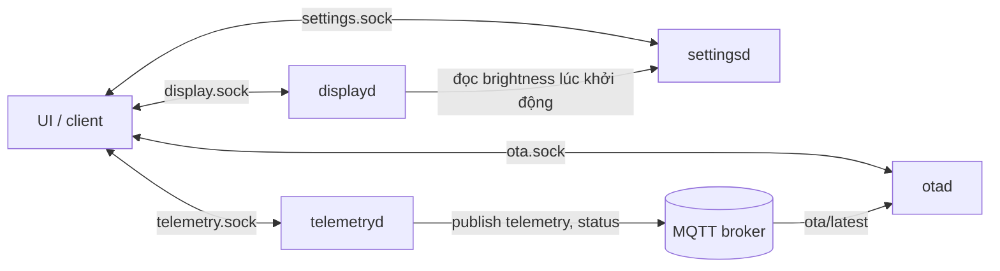
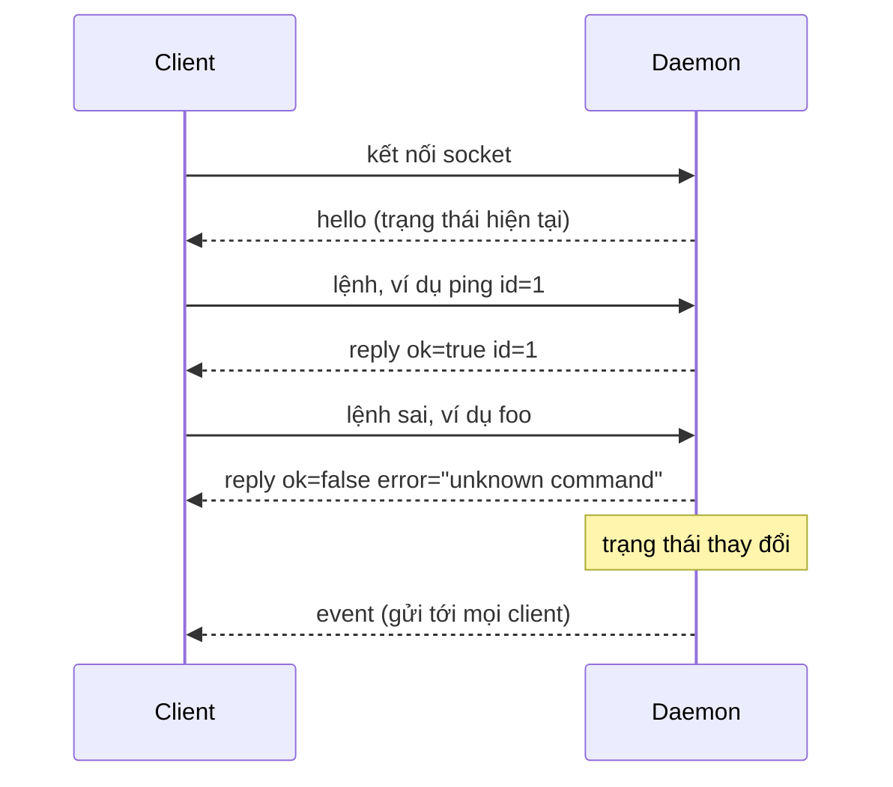
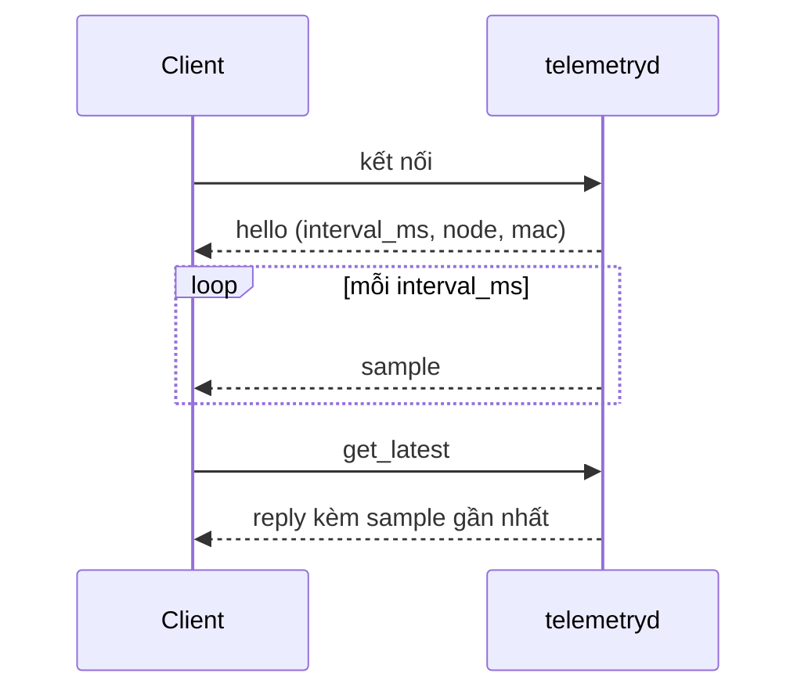
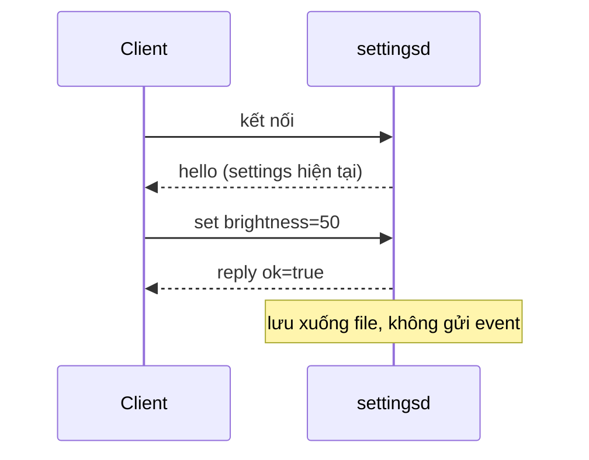
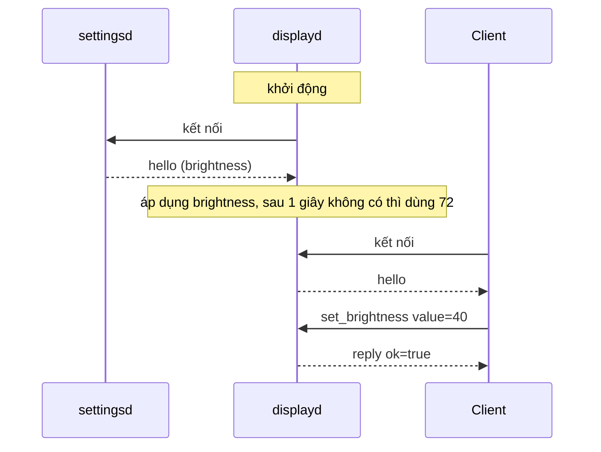
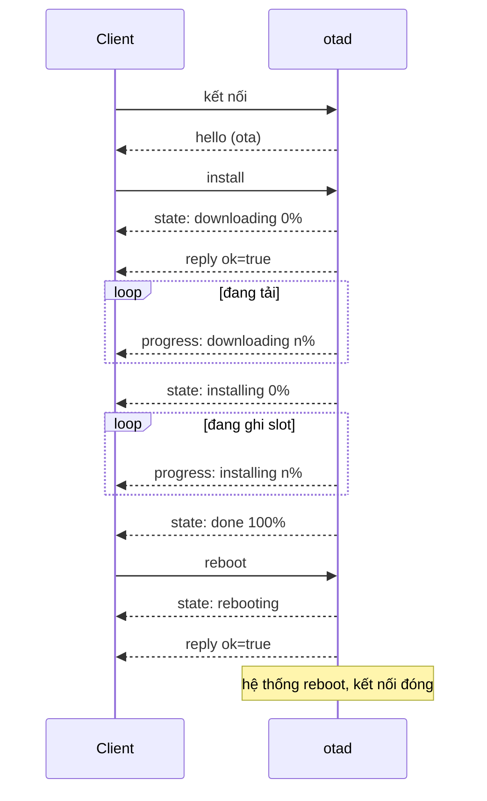
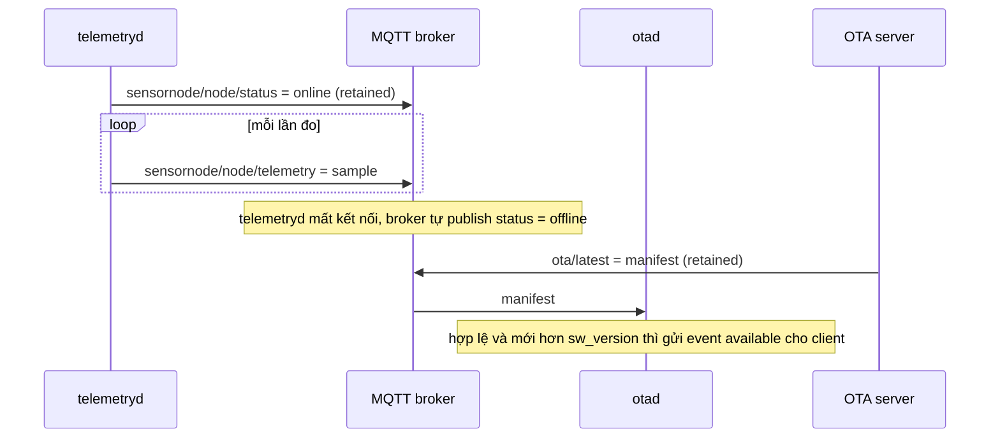

# Protocol của các daemon

Tài liệu mô tả cách client nói chuyện với các daemon của sensornode-core.

| Daemon | Socket | Quyền | Lệnh |
|---|---|---|---|
| telemetryd | `/run/sensornode/telemetry.sock` | `sensornode` | `ping`, `get_latest` |
| settingsd | `/run/sensornode/settings.sock` | `sensornode` | `ping`, `set` |
| displayd | `/run/sensornode/display.sock` | root | `ping`, `set_brightness` |
| otad | `/run/sensornode/ota.sock` | root | `ping`, `status`, `install`, `reboot` |



## Một phiên kết nối

Bốn daemon dùng chung trình tự này:



1. Client kết nối, daemon gửi ngay `hello`.
2. Client gửi lệnh, daemon trả đúng một `reply` cho mỗi lệnh, theo thứ tự đã gửi.
3. Khi trạng thái đổi, daemon gửi event tới mọi client đang kết nối.

Client nên lấy trạng thái từ `hello` rồi cập nhật theo event, không cần hỏi định kỳ. Event có thể đến xen giữa lệnh và reply nên luôn phân biệt message bằng trường `type`.

### Lệnh

**Client gửi**

```json
{
    "cmd": "ping",
    "id": 1
}
```

| Trường | Bắt buộc | Ý nghĩa |
|---|---|---|
| `cmd` | Có | Tên lệnh |
| `id` | Không | Bất kỳ giá trị JSON nào, được trả lại nguyên vẹn trong reply |

**Daemon trả về**, khi thành công và khi lỗi:

```json
{
    "cmd": "ping",
    "id": 1,
    "ok": true,
    "type": "reply"
}

{
    "cmd": "foo",
    "error": "unknown command",
    "ok": false,
    "type": "reply"
}
```

| Field | Ý nghĩa |
|---|---|
| `type` | Luôn là `reply` |
| `ok` | `true` nếu lệnh được nhận |
| `error` | Lý do, chỉ có khi `ok` là `false` |
| `cmd`, `id` | Lặp lại từ lệnh. Không có nếu lệnh thiếu hoặc không parse được |

### Lỗi chung

| `error` | Nguyên nhân |
|---|---|
| `invalid json` | Dòng không phải object JSON |
| `missing cmd` | Thiếu `cmd` hoặc `cmd` không phải chuỗi |
| `unknown command` | Daemon không hỗ trợ lệnh này |

### Giới hạn kết nối

| Giới hạn | Giá trị | Vượt quá thì |
|---|---|---|
| Độ dài một dòng | 4096 byte | Daemon đóng kết nối |
| Số client cùng lúc | 16 | Client mới bị từ chối |
| Dữ liệu chờ gửi cho một client | 64 KB | Daemon đóng kết nối với client đọc chậm |

Thư mục `/run/sensornode` thuộc group `sensornode` với quyền `2770`, socket có quyền `0660`. Client phải chạy với user thuộc group `sensornode`.

### Test nhanh

```bash
socat - UNIX-CONNECT:/run/sensornode/telemetry.sock
{"cmd":"get_latest","id":1}
```

Trên host, chạy daemon với `-s <đường dẫn socket>` để không cần quyền root.

## telemetryd

Đọc cảm biến theo chu kỳ, lưu SQLite và publish MQTT.



### Daemon tự gửi: `hello`

```json
{
    "daemon": "telemetryd",
    "interval_ms": 5000,
    "mac": "64:cf:d9:d7:21:24",
    "node": "64cfd9d72124",
    "type": "hello",
    "version": "0.1.0"
}
```

| Field | Ý nghĩa |
|---|---|
| `interval_ms` | Chu kỳ đo |
| `node` | Device id, dùng trong topic MQTT |
| `mac` | MAC dùng để sinh `node`, `null` nếu không đọc được |

### Daemon tự gửi: event `sample`

Gửi sau mỗi lần đo.

```json
{
    "errors": [],
    "humi_rh": 54.48,
    "lux": 310.47,
    "temp_c": 24.16,
    "ts": 1793691286913,
    "type": "sample"
}
```

| Field | Kiểu | Ý nghĩa |
|---|---|---|
| `ts` | int | Thời điểm đo, unix milliseconds |
| `temp_c` | number hoặc `null` | Nhiệt độ °C, làm tròn 2 chữ số |
| `humi_rh` | number hoặc `null` | Độ ẩm %RH |
| `lux` | number hoặc `null` | Ánh sáng lux |
| `errors` | array | Cảm biến lỗi trong lần đo này |

Cảm biến lỗi thì giá trị tương ứng là `null`. `error` là mô tả errno của lần đọc I2C bị lỗi.

```json
{
    "errors": [
        {
            "error": "<strerror>",
            "sensor": "sht30"
        }
    ],
    "humi_rh": null,
    "lux": 310.47,
    "temp_c": null,
    "ts": 1793691286913,
    "type": "sample"
}
```

### Lệnh `get_latest`

Lấy lần đo gần nhất.

**Client gửi**

```json
{
    "cmd": "get_latest",
    "id": 1
}
```

**Daemon trả về**

```json
{
    "cmd": "get_latest",
    "id": 1,
    "ok": true,
    "sample": {
        "errors": [],
        "humi_rh": 54.48,
        "lux": 310.47,
        "temp_c": 24.16,
        "ts": 1793691286913
    },
    "type": "reply"
}
```

`sample` có cùng field với event `sample`, không có `type`.

| `error` | Nguyên nhân |
|---|---|
| `no sample yet` | Chưa đo lần nào |

## settingsd

Lưu các thông số người dùng đổi được.



| Key | Kiểu | Mặc định | Giá trị hợp lệ |
|---|---|---|---|
| `brightness` | int | `72` | `0` đến `100` |
| `auto_mode` | bool | `false` | `true`, `false` |

### Daemon tự gửi: `hello`

```json
{
    "daemon": "settingsd",
    "settings": {
        "auto_mode": false,
        "brightness": 72
    },
    "type": "hello",
    "version": "0.1.0"
}
```

### Lệnh `set`

Đổi một thông số.

**Client gửi**

```json
{
    "cmd": "set",
    "id": 2,
    "key": "brightness",
    "value": 50
}
```

**Daemon trả về**

```json
{
    "cmd": "set",
    "id": 2,
    "ok": true,
    "type": "reply"
}
```

| `error` | Nguyên nhân |
|---|---|
| `unknown key` | Thiếu `key` hoặc key không có trong bảng thông số |
| `invalid value` | Thiếu `value`, sai kiểu hoặc ngoài khoảng |

settingsd không có event. Thay đổi từ một client không được báo cho các client khác; giá trị mới chỉ có trong `hello` của lần kết nối sau.

## displayd

Điều khiển đèn nền màn hình.



### Daemon tự gửi: `hello`

```json
{
    "daemon": "displayd",
    "type": "hello",
    "version": "0.1.0"
}
```

### Lệnh `set_brightness`

Đặt độ sáng ngay, không lưu.

**Client gửi**

```json
{
    "cmd": "set_brightness",
    "id": 2,
    "value": 40
}
```

**Daemon trả về**

```json
{
    "cmd": "set_brightness",
    "id": 2,
    "ok": true,
    "type": "reply"
}
```

| `error` | Nguyên nhân |
|---|---|
| `invalid value` | `value` không phải số nguyên từ `0` đến `100` |
| `backlight write failed` | Ghi sysfs backlight lỗi |

Muốn giữ độ sáng qua reboot thì gửi thêm `set` với key `brightness` tới settingsd.

## otad

### Luồng cài đặt



Reply của `install` và `reboot` chỉ báo lệnh đã được nhận, kết quả đến qua event `state`. Event `state` đầu tiên có thể đến trước reply như trong sơ đồ.

Nếu cài lỗi, event cuối là `state: failed` kèm `error`. Nếu lệnh reboot lỗi, otad quay về `state: done` kèm `error`.

### Object `ota`

Trạng thái OTA, có mặt trong `hello`, reply của `status` và mọi event.

```json
{
    "available": {
        "sha256": "075b...",
        "size": 47127040,
        "url": "http://192.168.137.10:8000/release/x-0.3.0.swu",
        "version": "0.3.0"
    },
    "error": null,
    "percent": 40,
    "state": "downloading",
    "url": "http://192.168.137.10:8000/release/x-0.3.0.swu"
}
```

| Field | Ý nghĩa |
|---|---|
| `state` | `idle`, `downloading`, `installing`, `done`, `failed`, `rebooting` |
| `percent` | `0` đến `100` khi đang tải hoặc cài, `100` ở `done` và `rebooting`, còn lại `null` |
| `url` | url của lần cài gần nhất, `null` nếu chưa cài |
| `error` | Lỗi cài ở `failed`, hoặc lỗi lệnh reboot ở `done`. Còn lại `null` |
| `available` | Manifest bản mới hơn firmware đang chạy, `null` nếu không có |

`available` độc lập với `state`: ở `failed` vẫn có thể có bản mới để cài lại.

### Daemon tự gửi: `hello`

```json
{
    "daemon": "otad",
    "ota": { ... },
    "type": "hello",
    "version": "0.1.0"
}
```

### Daemon tự gửi: event

| `type` | Khi nào |
|---|---|
| `state` | `ota.state` đổi |
| `progress` | `ota.percent` đổi trong lúc tải hoặc cài |
| `available` | `ota.available` đổi, ví dụ có manifest mới qua MQTT |

```json
{
    "ota": {
        ...
        "percent": 10,
        "state": "downloading"
    },
    "type": "progress"
}
```

### Lệnh `status`

Hỏi trạng thái OTA và trạng thái A/B của hệ thống.

**Client gửi**

```json
{
    "cmd": "status",
    "id": 1
}
```

**Daemon trả về**

```json
{
    "cmd": "status",
    "id": 1,
    "ok": true,
    "ota": { ... },
    "system": {
        "active_slot": "A",
        "boot_count": 0,
        "boot_limit": 3,
        "errors": [],
        "running_slot": "A",
        "sw_version": "0.2.0",
        "ustate": 0
    },
    "type": "reply"
}
```

| Field của `system` | Nguồn | Ý nghĩa |
|---|---|---|
| `sw_version` | `/etc/sw-versions` | Version firmware đang chạy |
| `running_slot` | `root=` trong `/proc/cmdline` | Slot đang chạy, `A` hoặc `B` |
| `active_slot` | U-Boot env | Slot sẽ boot lần tới |
| `ustate` | U-Boot env | `1` khi có bản chưa commit |
| `boot_count` | U-Boot env | Số lần đã boot thử |
| `boot_limit` | U-Boot env | Boot thử quá số này thì rollback |
| `errors` | | Nguồn đọc lỗi, dạng `{"source":"bootenv","error":"..."}` |

Field không đọc được có giá trị `null`. Kết hợp các field:

| Điều kiện | Ý nghĩa |
|---|---|
| `ustate=1`, `running_slot` khác `active_slot` | Đã cài xong, chờ reboot |
| `ustate=1`, `running_slot` bằng `active_slot` | Đang boot thử bản mới, chưa commit |

otad không phát event khi `ota-confirm-boot` commit. Client muốn biết lúc commit xong phải gửi lại `status`.

### Lệnh `install`

Cài firmware. Có `url` thì cài từ url đó, không có thì cài bản trong `ota.available`.

**Client gửi**

```json
{
    "cmd": "install",
    "id": 3,
    "url": "http://192.168.137.10:8000/release/x-0.3.0.swu"
}
```

**Daemon trả về**

```json
{
    "cmd": "install",
    "id": 3,
    "ok": true,
    "type": "reply"
}
```

Sau đó otad tự gửi các event `state` và `progress` như trong sơ đồ luồng cài đặt.

### Lệnh `reboot`

Khởi động vào slot vừa cài, chỉ nhận ở `done`.

**Client gửi**

```json
{
    "cmd": "reboot",
    "id": 4
}
```

**Daemon trả về**

```json
{
    "cmd": "reboot",
    "id": 4,
    "ok": true,
    "type": "reply"
}
```

### Lỗi

| `error` | Lệnh | Nguyên nhân |
|---|---|---|
| `no update available` | `install` | Không có url và chưa có `ota.available` |
| `invalid url` | `install` | url không phải chuỗi http(s), rỗng, có khoảng trắng hoặc dài quá 1024 ký tự |
| `busy` | `install`, `reboot` | Đang tải hoặc cài |
| `reboot pending` | `install` | Đã cài xong, phải reboot trước |
| `trial boot` | `install` | Bản đang chạy chưa được commit |
| `no update installed` | `reboot` | Chưa cài xong bản nào |
| `already rebooting` | `reboot` | Lệnh reboot trước đang chạy |

## MQTT



### telemetryd publish

| Topic | QoS | Retain | Payload |
|---|---|---|---|
| `sensornode/<node>/status` | 1 | Có | `online` khi kết nối, `offline` là Last Will |
| `sensornode/<node>/telemetry` | 1 | Không | Sample, cùng field với event `sample`, không có `type` |

```json
{
    "errors": [],
    "humi_rh": 54.48,
    "lux": 310.47,
    "temp_c": 24.16,
    "ts": 1793691286913
}
```

Sample được lưu trước rồi mới gửi. Khi mất kết nối, các sample còn thiếu được gửi lại theo thứ tự `ts` lúc kết nối lại. Giao hàng là at-least-once: phía nhận có thể thấy trùng và cần loại trùng theo cặp `(node, ts)`.

### otad subscribe

| Topic | Payload |
|---|---|
| `ota/latest` | Manifest bản firmware mới nhất, nên publish dạng retained |

```json
{
    "version": "0.3.0",
    "url": "http://192.168.137.10:8000/release/x-0.3.0.swu",
    "size": 47127040,
    "sha256": "075bcf..."
}
```

| Key | Kiểu | Bắt buộc | Điều kiện |
|---|---|---|---|
| `version` | string | Có | 1 đến 64 ký tự `[0-9A-Za-z.+_~-]`, bắt đầu bằng chữ số |
| `url` | string | Có | Như url của lệnh `install` |
| `size` | int | Không | `>= 0` |
| `sha256` | string | Không | 64 ký tự hex |

Manifest sai bị bỏ qua và otad giữ bản trước. Payload rỗng xoá bản đang giữ, nên `mosquitto_pub -r -n` dùng để gỡ manifest retained. Manifest có `version` không mới hơn `sw_version` cho kết quả `available` là `null`, trừ khi otad chạy với `--force-update`.
